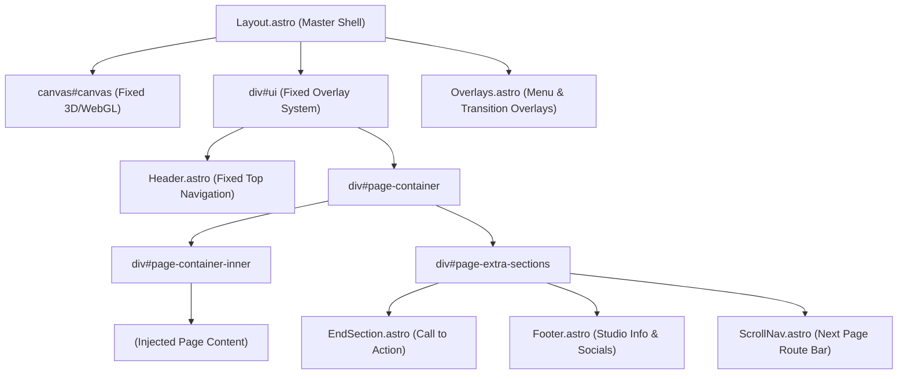

# KYNDEV Live Front-End Design System Specification

> **Source of Truth**: Extracted strictly from the live front-end website (`src/pages/index.astro`, `src/pages/about.astro`, `src/pages/projects/*`, `src/layouts/Layout.astro`, `src/styles/kyndev.css`, and `src/components/*`).  
> **Exclusions**: Purely isolated from experimental `v2` and `v3` codebases.

---

## 1. Design System Foundations & Design Tokens

All tokens are defined in `:root` inside [`src/styles/kyndev.css`](file:///Users/waqas/DEV/kyndev.com/src/styles/kyndev.css).

### 1.1 Color Palette

| Token Name | Value | Role / Usage |
| :--- | :--- | :--- |
| `--color-blue` | `#1a2ffb` | Primary electric brand accent, interactive elements |
| `--header-color` | `#0016ec` | Header buttons, brand navigation active states |
| `--color-dark-blue`| `#071bdf` | Deep blue accents, gradient stops |
| `--color-white` | `#ffffff` | Background default for light theme, primary high-contrast text |
| `--color-black` | `#000000` | Canvas base, primary dark text, inverted mode |
| `--color-off-white` | `#f0f1fa` | Secondary background, subtle text on dark backgrounds |
| `--color-dark-white`| `#e4e6ef` | Border dividers, subtle card background fills |
| `--color-off-white-semi` | `rgba(240, 241, 250, 0.7)` | Translucent overlays and backdrop blurs |
| `--color-grey-blue`| `#2b2e3a` | Muted neutral, tag backgrounds, borders |
| `--color-green` | `#c1ff00` | Neon volt accent, progress bar fill in `ScrollNav` |
| `--color-red` | `#ff4c41` | Warm warning accent |
| `--color-error` | `#e90000` | Critical alert / form error states |
| `--color-purple` | `#8832f7` | Secondary creative accent |

#### Dynamic Project Detail Tokens (Case Studies)
Injected dynamically per project via `style={project.theme.style}`:
- `--project-details-bg`: Case study ambient background color
- `--project-details-highlight`: Case study accent highlight
- `--project-details-btn-bg` / `--project-details-btn-text`
- `--project-details-btn-bg-hover` / `--project-details-btn-text-hover`

---

### 1.2 Typography & Font Hierarchy

The typography scale utilizes fluid responsive `clamp()` units.

#### Font Families
1. **Headings, Display & Body**: `Aeonik`
   - `Aeonik-Regular` (weight: 400, normal)
   - `Aeonik-Medium` (weight: 500, medium)
   - `Aeonik-RegularItalic` (weight: 400, italic)
2. **Telemetry, Tickers & Metadata**: `IBMPlexMono` & `LusionMono`
   - `IBMPlexMono-Regular` (weight: 400)
   - `IBMPlexMono-Medium` (weight: 500)
   - `LusionMono` (weight: 400)
3. **Display Wordmark**: `Space Grotesk` (used in specific SVG branding headers)

#### Fluid Type Scale
- `.text-xs`: `0.75em`
- `.text-base`: `clamp(1rem, 1.5vw, 2rem)` (Mobile $\le$ 812px: `0.875em`)
- `.text-lg`: `1.75em` (Mobile $\le$ 812px: `1.5em`)
- `.text-4xl`: `clamp(7em, 8vw, 20em)` (Mobile $\le$ 812px: `13vw`)
- **Display Hero Headings**: `clamp(2rem, 3.5vw, 5rem)` desktop, `6vw` on mobile
- **Navigation Ticker Titles**: `3.5em` with `line-height: 1em`

---

### 1.3 Spatial System & Grid Architecture

The layout relies on a mathematically derived 12-column grid system with fluid viewport margins.

```css
:root {
  --grid-gap: 2vw;
  --grid-space: calc((100% - 11 * var(--grid-gap)) / 12);
  --base-padding-x: max(5vw, 40px);
  --base-padding-y: clamp(30px, 4vw, 50px);
  --global-border-radius: 20px;
  --header-size: clamp(1rem, 1vw, 2rem);
  --cross-size: clamp(0.875rem, 1vw, 2rem);
}

@media (max-width: 812px) {
  :root {
    --grid-gap: 4vw;
    --global-border-radius: 10px;
    --base-padding-x: 25px;
    --base-padding-y: 25px;
  }
}

@media (max-width: 400px) {
  :root {
    --base-padding-x: 15px;
    --base-padding-y: 15px;
  }
}
```

#### Section Grid Class
Every page section conforms to `.section`:
```css
.section {
  position: relative;
  width: 100%;
  display: grid;
  grid-template-columns: repeat(12, minmax(0, 1fr));
  column-gap: var(--grid-gap);
  padding: var(--base-padding-y) var(--base-padding-x);
}

@media (max-width: 812px) {
  .section {
    grid-template-columns: repeat(6, minmax(0, 1fr));
  }
}
```

---

## 2. Page & Shell Architecture

Every page on the live website is driven by [`src/layouts/Layout.astro`](file:///Users/waqas/DEV/kyndev.com/src/layouts/Layout.astro).



---

## 3. Core Component Library

### 3.1 Top Navigation (`Header.astro`)
- **Position**: Fixed top overlay (`#header`).
- **Logo**: Exclusion blend-mode logo SVG on left (`#header-logo`).
- **Interactive Controls**:
  - Sound toggle (`#header-right-sound-btn`, hidden on mobile).
  - Talk button (`#header-right-talk-btn`) with animated dots expanding to arrow hover state.
  - Hamburger Menu button (`#header-right-menu-btn`) triggering 3-bar rotation and full-screen menu overlay.

### 3.2 Alignment Cross Pins (`.cross`)
A hallmark motif of the KYNDEV aesthetic:
- 4-cross or 5-cross pin arrays positioned absolutely on bounding box perimeters:
  - `.home-hero-scroll-container-cross`
  - `.about-cross`
  - `.end-section-content-cross`
  - `.scroll-nav-cross`
- Built cleanly with CSS `:before` and `:after` pseudo-elements rotated at 90 degrees.

### 3.3 Call to Action Transition (`EndSection.astro`)
- Big typography display: *"Is Your Big Idea Ready to Go Wild?"*
- Animated dual arrow indicators pointing to direct conversation trigger.
- Embedded cross-pin layout alignment.

### 3.4 Continuous Page Router (`ScrollNav.astro`)
- Bottom sticky navigation bar that connects pages smoothly:
  - Displays `SUBTITLE` (e.g. `NEXT`, `EXPLORE`)
  - Displays large route destination title (e.g. `ABOUT US`, `PROJECTS`)
  - Integrated progress track with neon green bar (`--color-green`) and directional arrow.

### 3.5 Global Footer (`Footer.astro`)
- 12-column grid layout with studio details:
  - Locations (Tokyo / London / Remote)
  - Direct inquiry email
  - Social media outbound links with external arrow icon
  - Newsletter subscription input with inline submit
  - Copyright and legal credits

---

## 4. Main Page Consistency Review & Audit

An in-depth review across existing live pages (`index.astro`, `about.astro`, `projects/index.astro`, `projects/[slug].astro`):

| Page | Layout Wrapping | Grid Standard | Theme Sync | Status / Recommendations |
| :--- | :--- | :--- | :--- | :--- |
| **Home (`/`)** | `<Layout>` with `scrollNavPath="/about"` | Uses `.section` (12-col) | Light body + WebGL canvas interaction | Fully consistent. |
| **About (`/about`)** | `<Layout>` with `scrollNavPath="/projects"` | Uses `.section` with accordion matrices | Dark accents, 58-pt starburst, 4-card matrix | Fully consistent. |
| **Projects Index (`/projects`)** | `<Layout>` with `scrollNavPath="/about"` | Modular grid gallery | Dark theme with card hover states | Fully consistent. |
| **Project Case Study (`/projects/[slug]`)** | `<Layout>` with `scrollNavPath="/projects"` | Custom media grid with narrative blocks | Injects custom theme styles (`project.theme.style`) | High consistency; requires theme contract compliance. |

### Inconsistencies & Recommendations
1. **Page Outer Wrapper Standard**:
   - `index.astro` wraps its sections in `<div id="home" class="page">`.
   - `about.astro` wraps its sections in `<div id="about" class="page">`.
   - `projects/index.astro` places `<ProjectsGallery />` directly in `<slot />`.
   - *Recommendation for New Pages*: Always follow the `<div id="[page-id]" class="page">` wrapper pattern for uniform route transitions and hook targeting.
2. **Dynamic Project Theme Validation**:
   - For case study pages, ensure all 8 CSS variables (`--project-details-bg`, `--project-details-highlight`, etc.) are defined to avoid fallback flash.

---

## 5. Blueprint: Creating New Pages Following the Design System

When creating a new page (e.g. `src/pages/services.astro` or `src/pages/contact.astro`), strictly adhere to the following specification:

```astro
---
// src/pages/example.astro
import Layout from '../layouts/Layout.astro';
import ExampleSection from '../components/example/ExampleSection.astro';
---

<Layout
  title="KYNDEV - Page Title"
  description="Concise description matching KYNDEV voice and SEO standards."
  ogUrl="https://kyndev.com/example/"
  scrollNavPath="/next-route"
  scrollNavText="Next Route Title"
  scrollNavSubtitle="Next"
>
  <div id="example" class="page">
    <ExampleSection />
  </div>
</Layout>
```

### Component Structure Template for New Sections
```astro
---
// src/components/example/ExampleSection.astro
import './exampleSection.css';

interface Props {
  headline?: string;
}

const { headline = "Our Capabilities" } = Astro.props;
---

<section id="example-section" class="section">
  <!-- Cross alignment markers -->
  <div class="example-crosses">
    <div class="example-cross"></div>
    <div class="example-cross"></div>
  </div>

  <!-- Content spanning 12-column grid -->
  <div class="example-col-header">
    <span class="text-xs">01 / DISCOVERY</span>
    <h2 class="text-lg">{headline}</h2>
  </div>

  <div class="example-col-body">
    <p class="text-base">
      Crafting immersive digital experiences through precision engineering and design.
    </p>
  </div>
</section>
```
