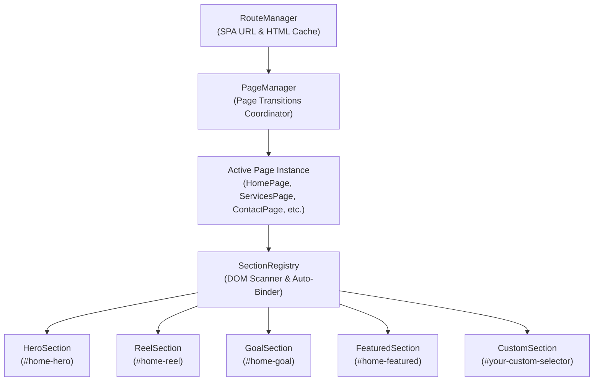

# KYNDEV Multi-Page Architecture & Dynamic Component Guide

Welcome to the definitive architecture and developer guide for building, extending, and scaling pages and interactive 3D sections across **KYNDEV**.

This guide covers:
1. [Core Architecture & Lifecycle Coordination](#1-core-architecture--lifecycle-coordination)
2. [SectionRegistry & Standalone Component Model](#2-sectionregistry--standalone-component-model)
3. [Building 10 to 20+ New Multi-Page Routes](#3-building-10-to-20-new-multi-page-routes)
4. [Enhancing, Modifying, or Trimming Sections](#4-enhancing-modifying-or-trimming-sections)
5. [Complete Component Elimination / Tree-Shaking](#5-complete-component-elimination--tree-shaking)
6. [Loader & Landing Animation Stability Fix](#6-loader--landing-animation-stability-fix)

---

## 1. Core Architecture & Lifecycle Coordination

The site operates on Astro for static file generation, coupled with a customized Single Page Application (SPA) client-side transition and Three.js WebGL engine.



### The Section Lifecycle Contract
Every interactive section implements a standardized lifecycle:

| Lifecycle Method | Purpose | Triggered By |
| :--- | :--- | :--- |
| `preInit(container, hostPage)` | Queries section DOM elements, initializes WebGL meshes, and parents meshes to `hostPage.preUfxContainer`. | Page mount / route enter |
| `init()` | Binds global interaction listeners, WebGL shader textures, and sub-systems. | When page enters initialized state |
| `resize(width, height)` | Splits text (`SplitType`), computes responsive canvas/element dimensions, and syncs DOM bounding rects. | Window resize & page show |
| `update(dt)` | Runs per-frame scroll distance calculations, scroll-driven transforms, video playback, and WebGL shader uniforms. | App animation frame loop |
| `hide()` / `_onPageHideStarted()` | Resets text states, pauses active HTML5 video streams, and silences section audios. | When navigating away from the page |

---

## 2. SectionRegistry & Standalone Component Model

All sections are completely decoupled from monolithic files into standalone controllers located in `src/scripts/runtime/sections/`:

- `HeroSection.js`: Interactive 3D balloon hero and split-title physics.
- `ReelSection.js`: Interactive video showreel texture, character rollups, and Vimeo modal integration.
- `FeaturedSection.js`: Interactive project showcase cards.
- `GoalSection.js`: 3D Space Tunnel glass and astronaut scene.
- `SectionRegistry.js`: Dynamic discovery engine that maps DOM selectors to section controllers.

### How Dynamic Discovery Works
When `Page.js` loads any page:
```javascript
// src/scripts/runtime/navigation/pages/Page.js
_initDynamicSections(container) {
  this.activeSections = sectionRegistry.detectSections(
    container || this.domContainer || document,
    this
  );
}
```
`SectionRegistry` iterates over all registered selectors. If `container.querySelector(selector)` exists in the DOM for that page, that section is dynamically attached to `this.activeSections`.

---

## 3. Building 10 to 20+ New Multi-Page Routes

Creating a new multi-page route in KYNDEV requires **zero manual WebGL boilerplate**:

### Step 1: Create the Astro Page
Create `src/pages/case-studies.astro`:

```astro
---
// src/pages/case-studies.astro
import Layout from '../layouts/Layout.astro';
import Reel from '../components/home/Reel/Reel.astro';
import Goal from '../components/home/Goal/Goal.astro';
---

<Layout
  title="KYNDEV - Case Studies"
  description="Explore our interactive design and engineering case studies."
  ogUrl="https://kyndev.com/case-studies/"
  scrollNavPath="/contact"
  scrollNavText="Get In Touch"
>
  <div id="case-studies" class="page">
    <!-- Place ANY interactive section here. It works automatically! -->
    <Reel />
    <Goal />
  </div>
</Layout>
```

### Step 2: Register the Page Controller (If Custom Route Hooks are Needed)
If the page only needs default behavior, it automatically inherits from `Page`. To customize route metadata, add `src/scripts/runtime/navigation/pages/CaseStudiesPage.js`:

```javascript
import Page from './Page.js';
import properties from '../../core/Properties.js';

class CaseStudiesPage extends Page {
  path = "case-studies";
  id = "case-studies";
  endVisualColor = properties.blueColorHex;
}

export const caseStudiesPage = new CaseStudiesPage();
export default caseStudiesPage;
```
Register it in `PageManager.pageList` and it will automatically handle transitions, 3D scene reparenting, and resize/update loops.

---

## 4. Enhancing, Modifying, or Trimming Sections

### Example: Customizing the Reel Section
To add or remove elements in the Reel section:

1. **Modify Markup**:
   Open `src/components/home/Reel/Reel.astro`. Add your new element, e.g.:
   ```html
   <div id="home-reel-badge" class="reel-badge">Featured 2026</div>
   ```
2. **Access in Controller**:
   Open `src/scripts/runtime/sections/ReelSection.js`. In `preInit(e, hostPage)`:
   ```javascript
   this.domBadge = container.querySelector("#home-reel-badge");
   ```
3. **Animate in Update**:
   In `update(e)`:
   ```javascript
   if (this.domBadge && r) {
     this.domBadge.style.opacity = math.fit(this.videoPlaceholderRatio, 0, 0.5, 0, 1);
   }
   ```
4. **Clean SplitType Handling**:
   Always revert SplitType before re-splitting to prevent nested DOM wrappers:
   ```javascript
   this.domTitle?._splitted?.revert?.();
   this.domTitle._splitted = new SplitType(this.domTitleInner, { types: "words" });
   ```

---

## 5. Complete Component Elimination / Tree-Shaking

If a component (e.g. `Goal`) is no longer wanted anywhere on the website:

1. **Remove from Pages**:
   Remove `<Goal />` from your `.astro` pages.
2. **Result**:
   Because `SectionRegistry` only mounts sections whose selectors exist in the DOM, having zero `<div id="home-goal">` elements in the DOM means `GoalSection` will **never** be initialized, **never** allocated in WebGL, and **never** executed in the requestAnimationFrame loop.
3. **To Completely Remove from the Build**:
   - Unregister it in `src/scripts/runtime/sections/index.js`:
     ```javascript
     // Remove: sectionRegistry.register("#home-goal", () => window.homeGoalSection);
     ```
   - Delete `src/components/home/Goal/`.
   - Your build bundle will naturally omit the unused component code without touching page transition logic.

---

## 6. Loader & Landing Animation Stability Fix

### The Problem
Previously, on the first landing, the counter animation completed and faded the page in, but at approximately 1.5 seconds, the page would abruptly restart and fade up a second time.

### The Root Cause
In `TransitionOverlay.js`, a 1500ms safety watchdog timer (`_safetyWatchdog`) was unconditionally started on the initial landing frame. When it expired, it dispatched `onHideTextCompleted`. `PageManager._onHideTextComplete()` received the signal and invoked `_showPage()` a second time, which restarted `e.show()`, resetting `showRatio: 0` and causing the double fade.

### The Fix
1. In `TransitionOverlay.js`, the watchdog is now strictly armed only when an actual route change text transition is requested (`needsShowText || needsHideText`):
   ```javascript
   if ((this.needsShowText || this.needsHideText) && !this._safetyWatchdog) { ... }
   ```
2. In `PageManager.js`, `_onHideTextComplete()` is guarded to ignore signals during the initial landing:
   ```javascript
   _onHideTextComplete() {
     if (!this.isFirstRoute) {
       this._showPage();
     }
   }
   ```
On initial load, `start()` triggers `_showPage()` once, and the transition finishes smoothly with zero double-triggering.
