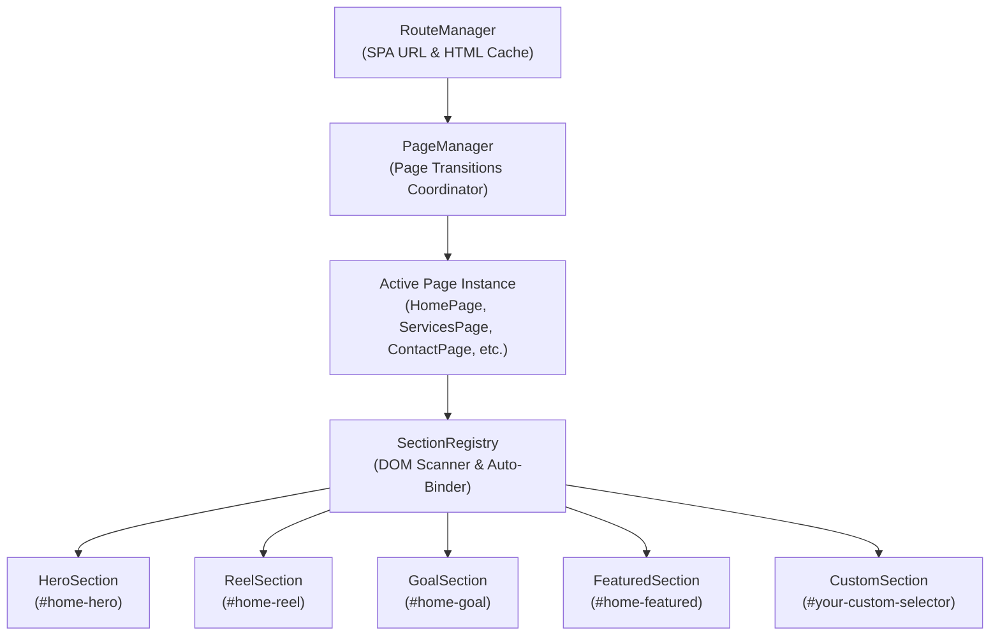
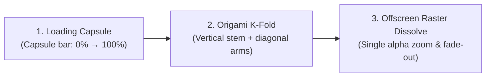

# KYNDEV Multi-Page Architecture & Dynamic Component Guide

Welcome to the definitive architecture and developer guide for building, extending, and scaling pages and interactive 3D sections across **KYNDEV**.

This guide covers:
1. [Core Architecture & Lifecycle Coordination](#1-core-architecture--lifecycle-coordination)
2. [SectionRegistry & Standalone Component Model](#2-sectionregistry--standalone-component-model)
3. [Building 10 to 20+ New Multi-Page Routes](#3-building-10-to-20-new-multi-page-routes)
4. [Enhancing, Modifying, or Trimming Sections](#4-enhancing-modifying-or-trimming-sections)
5. [Complete Component Elimination / Tree-Shaking](#5-complete-component-elimination--tree-shaking)
6. [Loader & Landing Animation Stability Fix](#6-loader--landing-animation-stability-fix)
7. [Brand "K" Preloader Morph & Live Transition Debugger](#7-brand-k-preloader-morph--live-transition-debugger)

---

## 1. Core Architecture & Lifecycle Coordination

The site operates on Astro for static file generation, coupled with a customized Single Page Application (SPA) client-side transition and Three.js WebGL engine.



### The Section Lifecycle Contract
Every interactive section implements a standardized lifecycle:

| Lifecycle Method | Purpose | Triggered By |
| :--- | :--- | :--- |
| `preInit(container, hostPage)` | Queries section DOM elements, initializes WebGL meshes, and parents meshes to `hostPage.preUfxContainer`. | Page mount / route enter |
| `init()` | Binds global interaction listeners, WebGL shader textures, and sub-systems. | When page enters initialized state |
| `resize(width, height)` | Splits text (`SplitType`), computes responsive canvas/element dimensions, and syncs DOM bounding rects. | Window resize & page show |
| `update(dt)` | Runs per-frame scroll distance calculations, scroll-driven transforms, video playback, and WebGL shader uniforms. | App animation frame loop |
| `hide()` / `_onPageHideStarted()` | Resets text states, pauses active HTML5 video streams, and silences section audios. | When navigating away from the page |

---

## 2. SectionRegistry & Standalone Component Model

All sections are completely decoupled from monolithic files into standalone controllers located in `src/scripts/runtime/sections/`:

- `HeroSection.js`: Interactive 3D balloon hero and split-title physics.
- `ReelSection.js`: Interactive video showreel texture, character rollups, and Vimeo modal integration.
- `FeaturedSection.js`: Interactive project showcase cards.
- `GoalSection.js`: 3D Space Tunnel glass and astronaut scene.
- `SectionRegistry.js`: Dynamic discovery engine that maps DOM selectors to section controllers.

### How Dynamic Discovery Works
When `Page.js` loads any page:
```javascript
// src/scripts/runtime/navigation/pages/Page.js
_initDynamicSections(container) {
  this.activeSections = sectionRegistry.detectSections(
    container || this.domContainer || document,
    this
  );
}
```
`SectionRegistry` iterates over all registered selectors. If `container.querySelector(selector)` exists in the DOM for that page, that section is dynamically attached to `this.activeSections`.

---

## 3. Building 10 to 20+ New Multi-Page Routes

Creating a new multi-page route in KYNDEV requires **zero manual WebGL boilerplate**:

### Step 1: Create the Astro Page
Create `src/pages/case-studies.astro`:

```astro
---
// src/pages/case-studies.astro
import Layout from '../layouts/Layout.astro';
import Reel from '../components/home/Reel/Reel.astro';
import Goal from '../components/home/Goal/Goal.astro';
---

<Layout
  title="KYNDEV - Case Studies"
  description="Explore our interactive design and engineering case studies."
  ogUrl="https://kyndev.com/case-studies/"
  scrollNavPath="/contact"
  scrollNavText="Get In Touch"
>
  <div id="case-studies" class="page">
    <!-- Place ANY interactive section here. It works automatically! -->
    <Reel />
    <Goal />
  </div>
</Layout>
```

### Step 2: Register the Page Controller (If Custom Route Hooks are Needed)
If the page only needs default behavior, it automatically inherits from `Page`. To customize route metadata, add `src/scripts/runtime/navigation/pages/CaseStudiesPage.js`:

```javascript
import Page from './Page.js';
import properties from '../../core/Properties.js';

class CaseStudiesPage extends Page {
  path = "case-studies";
  id = "case-studies";
  endVisualColor = properties.blueColorHex;
}

export const caseStudiesPage = new CaseStudiesPage();
export default caseStudiesPage;
```
Register it in `PageManager.pageList` and it will automatically handle transitions, 3D scene reparenting, and resize/update loops.

---

## 4. Enhancing, Modifying, or Trimming Sections

### Example: Customizing the Reel Section
To add or remove elements in the Reel section:

1. **Modify Markup**:
   Open `src/components/home/Reel/Reel.astro`. Add your new element, e.g.:
   ```html
   <div id="home-reel-badge" class="reel-badge">Featured 2026</div>
   ```
2. **Access in Controller**:
   Open `src/scripts/runtime/sections/ReelSection.js`. In `preInit(e, hostPage)`:
   ```javascript
   this.domBadge = container.querySelector("#home-reel-badge");
   ```
3. **Animate in Update**:
   In `update(e)`:
   ```javascript
   if (this.domBadge && r) {
     this.domBadge.style.opacity = math.fit(this.videoPlaceholderRatio, 0, 0.5, 0, 1);
   }
   ```
4. **Clean SplitType Handling**:
   Always revert SplitType before re-splitting to prevent nested DOM wrappers:
   ```javascript
   this.domTitle?._splitted?.revert?.();
   this.domTitle._splitted = new SplitType(this.domTitleInner, { types: "words" });
   ```

---

## 5. Complete Component Elimination / Tree-Shaking

If a component (e.g. `Goal`) is no longer wanted anywhere on the website:

1. **Remove from Pages**:
   Remove `<Goal />` from your `.astro` pages.
2. **Result**:
   Because `SectionRegistry` only mounts sections whose selectors exist in the DOM, having zero `<div id="home-goal">` elements in the DOM means `GoalSection` will **never** be initialized, **never** allocated in WebGL, and **never** executed in the requestAnimationFrame loop.
3. **To Completely Remove from the Build**:
   - Unregister it in `src/scripts/runtime/sections/index.js`:
     ```javascript
     // Remove: sectionRegistry.register("#home-goal", () => window.homeGoalSection);
     ```
   - Delete `src/components/home/Goal/`.
   - Your build bundle will naturally omit the unused component code without touching page transition logic.

---

## 6. Loader & Landing Animation Stability Fix

### The Problem
Previously, on the first landing, the counter animation completed and faded the page in, but at approximately 1.5 seconds, the page would abruptly restart and fade up a second time.

### The Root Cause
In `TransitionOverlay.js`, a 1500ms safety watchdog timer (`_safetyWatchdog`) was unconditionally started on the initial landing frame. When it expired, it dispatched `onHideTextCompleted`. `PageManager._onHideTextComplete()` received the signal and invoked `_showPage()` a second time, which restarted `e.show()`, resetting `showRatio: 0` and causing the double fade.

### The Fix
1. In `TransitionOverlay.js`, the watchdog is now strictly armed only when an actual route change text transition is requested (`needsShowText || needsHideText`):
   ```javascript
   if ((this.needsShowText || this.needsHideText) && !this._safetyWatchdog) { ... }
   ```
2. In `PageManager.js`, `_onHideTextComplete()` is guarded to ignore signals during the initial landing:
   ```javascript
   _onHideTextComplete() {
     if (!this.isFirstRoute) {
       this._showPage();
     }
   }
   ```
On initial load, `start()` triggers `_showPage()` once, and the transition finishes smoothly with zero double-triggering.

---

## 7. Brand "K" Preloader Morph & Live Transition Debugger

### Overview
In `src/scripts/runtime/ui/TransitionOverlay.js`, the legacy Lusion "L" origami animation and retro pixelated "LOADING" text were replaced with the branded **KYNDEV "K" preloader & route transition overlay**.

The sequence operates across three smooth cinematic states:
1. **Initial Asset Load (`loadBarRatio`)**: A minimalist horizontal pill/progress capsule shows asset ingestion progress.
2. **Logo Morph (`lineTransformRatio` / `showTextRatio`)**: The capsule folds out into the 4 strokes of the geometric **K** logo.
3. **Reveal & Dissolve (`revealRatio` / `hideTextRatio`)**: The K smoothly zooms camera-forward and fades out in unison with the dark backdrop, revealing the interactive 3D hero page beneath.



---

### Geometry & Stroke Mathematical Model

The "K" consists of four rounded rectangles anchored at a shared central junction:
- **Junction Pivot**: `jX = -0.6`, `jY = 0`
- **Center Alignment Shift**: `kCtx.translate(-0.35 * effMorph, 0)`

| Stroke Component | Anchor Offset (`sx, sy`) | Dimensions (`sw, sh`) | Rotation Angle | Corner Radii `[tl, tr, br, bl]` |
| :--- | :--- | :--- | :--- | :--- |
| **Upper Vertical Stem** | `(-2.1, -0.5)` | `(2.1, 1)` | `+effMorph * 90°` | `[strokeRadius, 0, 0, strokeRadius]` |
| **Lower Vertical Stem** | `(-2.1, -0.5)` | `(2.1, 1)` | `-effMorph * 90°` | `[strokeRadius, 0, 0, strokeRadius]` |
| **Upper Diagonal Arm** | `(0, -0.5)` | `(3.2, 1)` | `-effMorph * (180° * 0.233)` (~ -42°) | `[0, strokeRadius, strokeRadius, 0]` |
| **Lower Diagonal Arm** | `(0, -0.5)` | `(3.2, 1)` | `+effMorph * (180° * 0.233)` (~ +42°) | `[0, strokeRadius, strokeRadius, 0]` |

#### 1. Why the Vertical Spine has Zero Radius at the Center
If the vertical halves had all corners rounded, the middle where they meet at `y = 0` would create noticeable indentations, making the letter look like two split pieces.
- By setting inner junction corners to `0` and only outer ends to `strokeRadius`:
  ```javascript
  const stemRadii = [strokeRadius, 0, 0, strokeRadius];
  ```
- The vertical column forms a single, uninterrupted, straight pillar with rounded caps only at the very top and very bottom.

#### 2. Why Offscreen Canvas Rasterization (`_kCanvas`) is Critical
When multiple geometric shapes overlap (such as the diagonal arms overlapping the vertical stem at `jX = -0.6`), drawing them directly to the main screen with CSS or Canvas `globalAlpha < 1.0` causes the overlapping intersection area to appear twice as opaque, producing visible "seams" and "crosslines".
- **The Solution**: All four strokes are rasterized at 100% solid `#ffffff` onto an isolated offscreen canvas (`this._kCanvas`, 512×512).
- The offscreen buffer is then composited to the primary canvas in a single draw call with `u.globalAlpha = kAlpha`.
- Result: **Zero opacity seams**; the K dissolves as a single pristine vector symbol.

---

### How to Use the Live Interactive Debugger (`?debug-k`)

A real-time developer HUD is built directly into `TransitionOverlay.js`. It lets developers freeze the animation at any microsecond, manually scrub through morph and zoom states, and tweak corner radii interactively.

#### Activating the Debugger
You can activate the debugger in two ways:

1. **Via URL Query Parameter** (Recommended):
   Append `?debug-k` to any URL in your browser:
   ```
   http://localhost:4321/?debug-k
   http://localhost:4321/work?debug-k
   ```
2. **Via Browser Developer Tools Console**:
   ```javascript
   window.DEBUG_K = { active: true, morph: 1.0, reveal: 0.0, radius: 0.18, angle: 0.233 };
   ```

#### Debug HUD Controls

When active, a dark floating glassmorphic panel appears in the bottom-right corner:

| Control | Range | Purpose |
| :--- | :--- | :--- |
| **Freeze Checkbox** | `checked / unchecked` | Halts the timeline and prevents page fade-in so the overlay stays permanently frozen for pixel inspection. |
| **Morph Fold Slider** | `0.00` to `1.00` | Controls folding from the initial horizontal progress capsule (`0.0`) to the full **K** shape (`1.0`). |
| **Reveal Zoom & Fade Out** | `0.00` to `1.00` | Controls the camera zoom factor and alpha fade-out into the background page (`0.0 = solid`, `1.0 = invisible`). |
| **Corner Radius Slider** | `0.00` to `0.45` | Real-time adjustment of outer stroke corner rounding. Set to `0.0` for square brutalist caps or `0.18` for smooth modern pill ends. |
| **▶ Play Sequence** | Button | Runs a simulated 2.4-second full cycle (Morph $\to$ Brief Pause $\to$ Reveal Zoom) to test timing. |
| **Reset** | Button | Resets parameters back to default (`morph: 1.0, reveal: 0.0, radius: 0.18`). |

---

### How to Modify the Letter or Animation in the Future

All preloader morph configuration lives in [`src/scripts/runtime/ui/TransitionOverlay.js`](file:///Users/waqas/DEV/kyndev.com/src/scripts/runtime/ui/TransitionOverlay.js).

#### 1. Adjusting Diagonal Arm Angle (Flatter or Steeper Wings)
Find `armAngle` in `TransitionOverlay.update()`:
```javascript
// Default is ~42 degrees (Math.PI * 0.233)
const armAngle = this.debug.active ? this.debug.angle : 0.233;
```
- To make arms steeper (more vertical): Decrease to `0.18` (~32°).
- To make arms flatter (wider spread): Increase to `0.25` (45°).

#### 2. Changing Arm or Stem Lengths
In `TransitionOverlay.update()`:
```javascript
// Vertical stem height (currently 2.1 units each, total height 4.2 units):
drawSegment(-2.1, -0.5, 2.1, 1, stemRadii, effMorph * Math.PI * 0.5);

// Diagonal wing length (currently 3.2 units):
drawSegment(0, -0.5, 3.2, 1, armRadii, -effMorph * (Math.PI * armAngle));
```
- To make the diagonal arms longer: Increase `3.2` to `3.6`.
- To make the entire letter taller: Increase stem length from `2.1` to `2.4`.

#### 3. Adjusting Stroke Thickness
The stroke height is currently `1` unit (`sh = 1`), with vertical center offset `sy = -0.5`.
To make the strokes thicker (e.g. `1.2` units):
```javascript
drawSegment(sx, -0.6, sw, 1.2, rad, angle);
```

#### 4. Tuning Animation Speeds & Easing
- Initial boot morph is sequenced in `src/scripts/runtime/ui/Preloader.js`:
  ```javascript
  // Line transform speed & delay
  this.lineTransformRatio = ease.expoInOut(math.fit(ratio, 0.7, 1.0, 0, 1));
  ```
- Route transition speeds are configured in `TransitionOverlay.update(e)`:
  ```javascript
  this.showTextRatio = Math.min(1, this.showTextRatio + e * 1.5);
  this.waitTextRatio = Math.min(1, this.waitTextRatio + e * 2.8);
  this.hideTextRatio = Math.min(1, this.hideTextRatio + e * 1.5);
  ```
Increase multipliers to speed up navigation transitions, or decrease for a slower, more deliberate transition.
