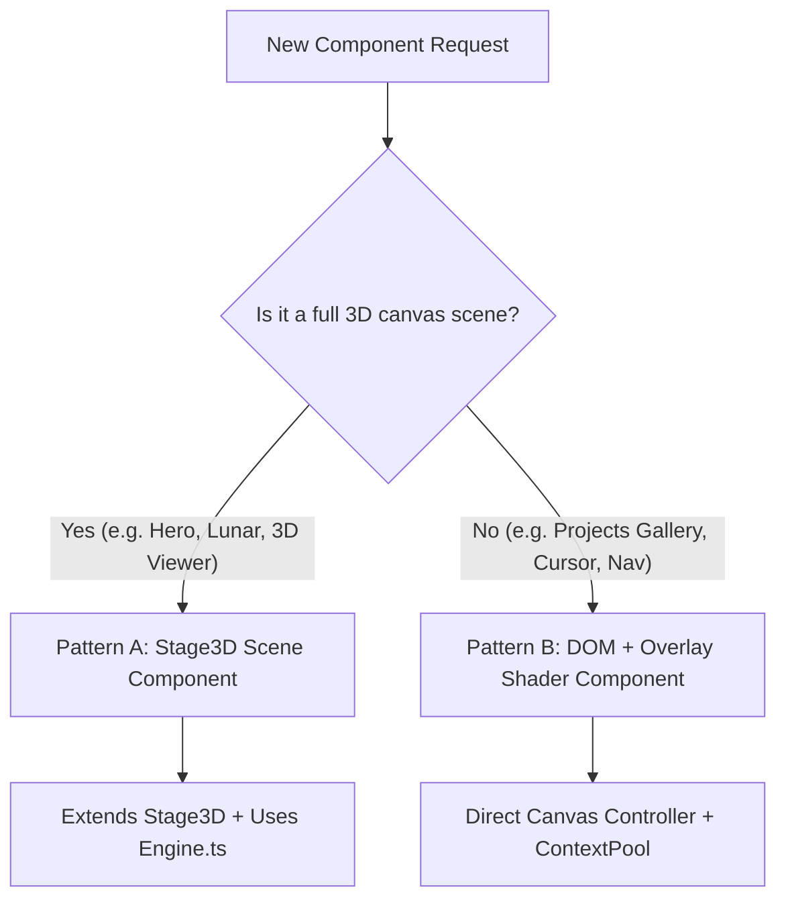

# Kyndev V2 &bull; Component Creation Workflow (SOP for Developers & AI Agents)

> **Standard Operating Procedure (SOP)**  
> Purpose: Rapidly extract and build isolated, modern, high-performance V2 components from monolithic assets or specifications without modifying existing production files.

---

## 1. Guiding Principles & Golden Rules

1. **Zero Impact on Legacy Code**:
   - Never modify `src/scripts/runtime.js` or existing live pages (`src/pages/index.astro`, `src/pages/projects/index.astro`, etc.).
   - All new code must reside strictly in `src/v2/components/<ComponentName>/` and previewed on `src/pages/preview/<component>.astro`.
2. **Modular Architecture**:
   - Each component must be self-contained: it contains its own controllers, shaders, styles, and Astro templates.
   - Reusable utilities (math, audio, context pooling, text animators) belong in `src/v2/shared/`.
   - Core 3D infrastructure belongs in `src/v2/core/`.
3. **Always Check WebGL Context Limits**:
   - Chrome enforces a maximum of 8–16 active WebGL contexts per tab.
   - Multi-canvas components (like card galleries) **must** use `src/v2/shared/webgl/ContextPool.ts` (capping active contexts to 4).
4. **Framed Presentation Standard**:
   - In preview pages, the canvas/3D element is framed inside a dark rounded viewport (`background: #0b0c0e; border-radius: 28px;`) placed on a pure white body (`#ffffff`).

---

## 2. Decision Tree: Scene Component vs. DOM/Overlay Component

Before writing code, decide which pattern fits the component:



---

## 3. Step-by-Step SOP: Building a New Component

### Step 1: Inspect the Monolithic Reference
1. Search the unpacked decompiled codebase:
   ```bash
   grep -in "<keyword>" src/scripts/unpacked-project/deobfuscated.js
   ```
2. Locate the corresponding class, shaders, uniforms, and math formulas (e.g., `UfxMesh`, `ease.expoOut`, `placementWeight`, `BufLoader`).
3. Identify binary asset paths (e.g., `/assets/models/*.buf`, `/assets/projects/**/*.webp`).

### Step 2: Scaffold the Component Directory
Create a new folder in `src/v2/components/<ComponentName>/`:
```
src/v2/components/<ComponentName>/
├── <ComponentName>.astro       # Main component markup & lifecycle mount
├── <ComponentName>Scene.ts     # (If Pattern A) Stage3D implementation
├── <ComponentName>Controller.ts# (If Pattern B) DOM / Pointer controller
├── <ComponentName>Shader.ts    # GLSL Shaders & Three.js ShaderMaterial
├── <componentName>.css         # Scoped styles
└── README.md                   # AI-readable component documentation
```

### Step 3: Implement Core Logic (Pattern A: Full 3D Scene)
1. Create `<ComponentName>Scene.ts` extending `Stage3D`:
   ```typescript
   import * as THREE from 'three';
   import { Stage3D } from '../../core/Stage3D';
   import { BufLoader } from '../../core/BufLoader';

   export class MyScene extends Stage3D {
     public async init(): Promise<void> {
       // 1. Load geometry via BufLoader
       const geometry = await BufLoader.load('/assets/models/model.buf');
       // 2. Setup materials, lights, and meshes
     }

     public update(delta: number, time: number): void {
       // Animation & physics loop
     }

     public resize(width: number, height: number): void {
       // Handle viewport updates
     }

     public destroy(): void {
       // Clean up geometries, textures, materials
     }
   }
   ```
2. Mount in `<ComponentName>.astro` using `Engine`:
   ```astro
   <canvas id="my-canvas"></canvas>

   <script>
     import { Engine } from '../../core/Engine';
     import { MyScene } from './MyScene';

     const canvas = document.getElementById('my-canvas') as HTMLCanvasElement;
     const engine = new Engine();
     engine.init(canvas);

     const scene = new MyScene();
     await scene.init();
     engine.setStage(scene);
     engine.start();
   </script>
   ```

### Step 4: Implement Core Logic (Pattern B: DOM/Overlay Component)
1. Use `IntersectionObserver` with threshold and root margins for lazy activation.
2. In multi-canvas components, register each renderer with `globalContextPool`:
   ```typescript
   import { globalContextPool } from '../../shared/webgl/ContextPool';
   // In activateContext():
   globalContextPool.request(this);
   ```
3. Use `math` and `ease` from `src/v2/shared/math.ts`:
   ```typescript
   import { math, ease } from '../../shared/math';
   const eased = ease.expoOut(progress);
   ```

### Step 5: Create Isolated Preview Page
Create `src/pages/preview/<component-name>.astro`:
1. Use standard white body layout with sticky header and back navigation link to `/preview`.
2. Wrap the component inside `.projects-viewport-container` (or `.hero-viewport-container`).
3. Add a variant toggle pill in the header if testing multiple variants.

### Step 6: Register in Component Lab Hub
Update `src/pages/preview/index.astro`:
Add the new component entry to the `components` array:
```typescript
{
  id: 'my-component',
  title: 'Component Title',
  description: 'Detailed description of features and shaders.',
  status: 'Ready to Preview',
  path: '/preview/my-component',
  badge: 'V2 Active',
  tech: ['Three.js', 'Custom Shader', 'TypeScript']
}
```

### Step 7: Create Component README.md
Every component **must** include a `README.md` containing:
1. Overview and visual effects.
2. File structure and responsibilities table.
3. Mathematics, physics equations, and shader uniforms.
4. Integration code snippet.
5. **AI Agent Prompt Cheatsheet** (table showing exact files and lines to modify for common user requests).

### Step 8: Validate Static Types & Syntax
Always verify with Astro check before reporting completion:
```bash
npx astro check
```
Ensure **0 errors** and **0 warnings**.
