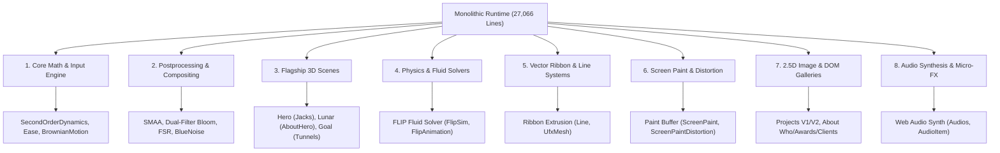
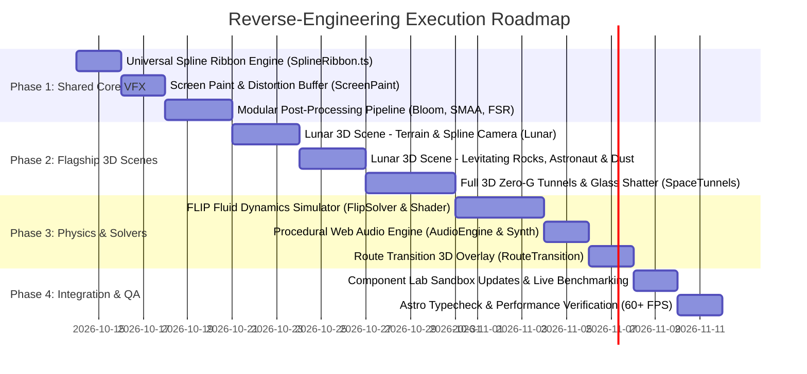

# Kyndev V2 &bull; Reverse-Engineering Master Plan

> **Master Plan & Technical Blueprint**  
> Source Monoliths: [`src/scripts/runtime.js`](file:///Users/waqas/DEV/kyndev.com/src/scripts/runtime.js) & [`src/scripts/unpacked-project/deobfuscated.js`](file:///Users/waqas/DEV/kyndev.com/src/scripts/unpacked-project/deobfuscated.js)  
> Target Architecture: [`src/v2/`](file:///Users/waqas/DEV/kyndev.com/src/v2/)

---

## 1. Executive Summary & Objective

The legacy Kyndev interactive web experience was built as a single monolithic script comprising **27,066 lines of JavaScript** across **134 classes**, containing tightly-coupled WebGL scenes, custom physics solvers, fluid dynamics engines, and audio synthesizers.

While a significant portion of UI components have been scaffolded into `src/v2/components/`, several flagship 3D scenes, physics simulations, and advanced shader effects remain trapped inside `runtime.js` / `deobfuscated.js`.

The objective of this plan is to **systematically decompose and reverse-engineer every remaining visual effect and simulation** into modular, isolated, TypeScript-driven V2 components and shared VFX modules, completely decoupling them from the legacy runtime while preserving **100% of visual fidelity and 60+ FPS performance**.

---

## 2. Monolithic Inventory & Component Extraction Matrix

Deconstructing [`deobfuscated.js`](file:///Users/waqas/DEV/kyndev.com/src/scripts/unpacked-project/deobfuscated.js) reveals 8 architectural domains:



### 2.1 Extraction Status Audit

| Domain / Effect | Legacy Classes in `deobfuscated.js` | Line Range | Assets Required | Current V2 Status | Target V2 Location |
| :--- | :--- | :--- | :--- | :--- | :--- |
| **Hero 3D Jacks Physics** | `HomeHeroSection`, `HomeBalloons`, `HomeBalloonsPhysics` | 4254–4910, 6283–6434 | `cross.buf`, `matcap.exr` | ✅ **Complete** | [`src/v2/components/Hero/`](file:///Users/waqas/DEV/kyndev.com/src/v2/components/Hero/) |
| **2.5D Projects Gallery V1** | `ProjectItem`, `ProjectItemList`, `ProjectsMainSection` | 8947–9297, 20828–20928 | Project webp textures | ✅ **Complete** | [`src/v2/components/Projects/`](file:///Users/waqas/DEV/kyndev.com/src/v2/components/Projects/) |
| **2.5D Projects Gallery V2** | `ProjectsPage`, `UfxMesh` | 20949–21527 | Project webp textures | ✅ **Complete** | [`src/v2/components/ProjectsV2/`](file:///Users/waqas/DEV/kyndev.com/src/v2/components/ProjectsV2/) |
| **Product 3D Viewer** | `ProjectDetailsScreen`, `OrbitControls` | 9945–10634, 13750–13977 | Coaster, Porsche, Cross .buf | ✅ **Complete** | [`src/v2/components/ProductViewer/`](file:///Users/waqas/DEV/kyndev.com/src/v2/components/ProductViewer/) |
| **Showreel Stage** | `HomeReelSection`, `Player`, `VideoOverlay` | 7770–8419, 8420–8896 | `mobile.mp4`, `desktop.mp4` | ✅ **Complete** | [`src/v2/components/Reel/`](file:///Users/waqas/DEV/kyndev.com/src/v2/components/Reel/) |
| **Featured Projects** | `HomeFeaturedSection` | 9298–9416 | Featured images | ✅ **Complete** | [`src/v2/components/Featured/`](file:///Users/waqas/DEV/kyndev.com/src/v2/components/Featured/) |
| **Goal Ribbon & Depth** | `GoalSection`, `GoalTunnels` (Ribbon) | 6616–7640, 13372–13749 | `line_goal.buf`, `astronaut_helmet.buf` | ⚠️ **Partial** (Ribbon only) | [`src/v2/components/Goal/`](file:///Users/waqas/DEV/kyndev.com/src/v2/components/Goal/) |
| **About Who / Team** | `AboutWhoSection`, `WhoSubsectionTeam` | 17614–18309 | Team photos, grid SVGs | ✅ **Complete** | [`src/v2/components/AboutWho/`](file:///Users/waqas/DEV/kyndev.com/src/v2/components/AboutWho/) |
| **About Clients Marquee** | `AboutClientSection`, `SVGParser` | 18310–20270 | SVG client logos | ✅ **Complete** | [`src/v2/components/AboutClients/`](file:///Users/waqas/DEV/kyndev.com/src/v2/components/AboutClients/) |
| **About Awards** | `AboutAwardSection` | 20275–20542 | Starburst medal SVGs | ✅ **Complete** | [`src/v2/components/AboutAwards/`](file:///Users/waqas/DEV/kyndev.com/src/v2/components/AboutAwards/) |
| **About Capabilities** | `AboutCapabilitySection` | 20543–20739 | Capability card glyphs | ✅ **Complete** | [`src/v2/components/AboutCapability/`](file:///Users/waqas/DEV/kyndev.com/src/v2/components/AboutCapability/) |
| **Case Study Gallery** | `ProjectDetailsSection`, `ProjectDetailsItem` | 14605–15293 | Project media | ✅ **Complete** | [`src/v2/components/ProjectDetails/`](file:///Users/waqas/DEV/kyndev.com/src/v2/components/ProjectDetails/) |
| **Lunar 3D Scene** | `AboutHero`, `AboutHeroGround`, `AboutHeroRocks`, `AboutHeroParticles`, `aboutHeroPerson`, `AboutHeroLines` | 15608–17475 (1,867 lines) | `terrain.buf`, `camera_spline.buf`, `person.buf`, `rock_*.buf` | ❌ **Queued (Not Extracted)** | [`src/v2/components/Lunar/`](file:///Users/waqas/DEV/kyndev.com/src/v2/components/Lunar/) |
| **FLIP Fluid Dynamics** | `FlipSim`, `FlipAnimation`, `PlaygroundPage` | 21528–22474 (946 lines) | `flip_texture.png`, grid colliders | ❌ **Not Extracted** | [`src/v2/components/FluidSimulation/`](file:///Users/waqas/DEV/kyndev.com/src/v2/components/FluidSimulation/) |
| **Screen Paint & Distortion** | `ScreenPaint`, `ScreenPaintDistortion` | 4103–4253, 24229–24291 (213 lines) | FBO ping-pong textures | ❌ **Not Extracted** | [`src/v2/shared/effects/ScreenPaint/`](file:///Users/waqas/DEV/kyndev.com/src/v2/shared/effects/ScreenPaint/) |
| **Full 3D Zero-G Tunnels & Shatter** | `GoalBlackTunnel`, `GoalWhiteTunnel`, `GoalTunnelAstronauts`, `GoalTunnelGlass`, `GoalWhiteTunnelParticles` | 9665–13285 (3,620 lines) | `grid_structure_hd.buf`, `broken_glass_animation.buf`, `astronaut_animations.buf` | ❌ **Queued (Deep 3D Ride)** | [`src/v2/components/SpaceTunnels/`](file:///Users/waqas/DEV/kyndev.com/src/v2/components/SpaceTunnels/) |
| **Universal 3D Spline Ribbon** | `Line`, `UfxMesh` | 6616–7640 (1,025 lines) | `.buf` spline curves (`line_*.buf`) | ⚠️ **Embedded only in Goal** | [`src/v2/core/SplineRibbon.ts`](file:///Users/waqas/DEV/kyndev.com/src/v2/core/SplineRibbon.ts) |
| **Modular Post-Processing Stack** | `Postprocessing`, `Smaa`, `Bloom`, `Fsr`, `BlueNoise` | 23464–24464 (1,000 lines) | `smaa-area.png`, `smaa-search.png` | ❌ **Not Extracted** | [`src/v2/core/postprocessing/`](file:///Users/waqas/DEV/kyndev.com/src/v2/core/postprocessing/) |
| **Procedural Audio Engine** | `Audios`, `AudioItem`, `GlobalAudios` | 5871–6282 (411 lines) | Web Audio API + `.ogg` audio files | ⚠️ **Basic audio.ts only** | [`src/v2/shared/audio/`](file:///Users/waqas/DEV/kyndev.com/src/v2/shared/audio/) |
| **Route Transition Overlay** | `TransitionOverlay`, `PageManager` | 22764–23141 (377 lines) | Fullscreen transition shaders | ❌ **Not Extracted** | [`src/v2/shared/transitions/`](file:///Users/waqas/DEV/kyndev.com/src/v2/shared/transitions/) |

---

## 3. The 8 Discrete Animation Effects to Reverse Engineer

### Effect 1: Lunar 3D Terrain & Spline Flight (`Lunar` / `AboutHero`)
- **Monolith Location**: `deobfuscated.js` lines 15608–17475 (~1,867 lines)
- **Visual Description**:
  A cinematic low-gravity lunar landscape. A camera glides along a complex 3D spline track through moon valleys, past levitating rocks with physical inertia, an animated zero-g astronaut standing on lunar soil, floating 3D typography, volumetric dust particles simulated via GPU FBO compute, and neon vector contour laser ribbons.
- **Sub-Modules to Extract**:
  1. `LunarTerrain`: Displaced ground mesh from `terrain.buf` with custom normal map, shadow projection, and heightmap texture (`terrain_shadow_light_height.webp`).
  2. `LunarSplineCamera`: Camera trajectory controller following `camera_spline.buf`, updating position, lookAt, and dolly-zoom FOV based on scroll progress.
  3. `LunarRocks`: Instanced or individual rock meshes (`rock_0.buf` through `rock_3.buf`) driven by 4 keyframe animation streams (`rock_animation_0.buf`–`3.buf`) and hover levitation physics.
  4. `LunarAstronaut`: Rigged character mesh (`person.buf` & `person_idle.buf`) with textured lunar suit (`person.webp`) and head tracking.
  5. `LunarDustParticles`: GPGPU double-buffered FBO particle simulation (`AboutHeroParticlesSimulation`) generating floating cosmic dust responding to pointer turbulence.
  6. `LunarLaserContours`: Neon spline paths (`terrain_lines.buf`) tracing topographic ridges.
  7. `LunarAtmosphere`: Volumetric depth fog and sun halo shader (`AboutHeroFog`, `AboutHeroHalo`).
- **Target Files**:
  ```
  src/v2/components/Lunar/
  ├── Lunar.astro
  ├── LunarScene.ts               # Extends Stage3D
  ├── LunarTerrain.ts             # Terrain mesh & shaders
  ├── LunarRocks.ts               # Rock physics & animation buffers
  ├── LunarParticlesFBO.ts        # GPGPU particle compute simulation
  ├── LunarAstronaut.ts           # Character loader & idle animation
  ├── LunarShaders.ts             # Vertex/Fragment GLSL shaders
  ├── lunar.css
  └── README.md
  ```
- **Preview Route**: `src/pages/preview/lunar.astro`

---

### Effect 2: FLIP Fluid Dynamics Simulation (`FluidSimulation` / `PlaygroundPage`)
- **Monolith Location**: `deobfuscated.js` lines 21528–22474 (~946 lines)
- **Visual Description**:
  Real-time 2D/3D Eulerian-Lagrangian Fluid-Implicit-Particle (FLIP) physics tank. Thousands of fluid particles pour, splash, collide with obstacles, and pool into a viscous body of liquid. The fluid is rendered with smooth metaball-like blending, refraction, and surface tension highlights.
- **Algorithmic Breakdown**:
  1. `Grid & Particle Allocation`: Staggered MAC grid (`fNumX * fNumY`) tracking horizontal ($u$) and vertical ($v$) velocity fields.
  2. `Particle Advection`: High-order RK2/RK4 particle movement through velocity fields.
  3. `P2G & G2P Transfers`: PIC/FLIP blending with ratio `FLIP_RATIO = 0.95` for vorticity preservation.
  4. `Pressure Poisson Solver`: Incompressible fluid solver iterating 60 times (`PRESSURE_ITERATION = 60`) with over-relaxation factor `1.9`.
  5. `Dynamic Colliders`: Interactive rectangular obstacles (`addColliderRect`) that deflect fluid jets.
  6. `Fluid Surface Shader`: Three.js shader material utilizing `flip_texture.png` and screen-space depth smoothing.
- **Target Files**:
  ```
  src/v2/components/FluidSimulation/
  ├── FluidSimulation.astro
  ├── FluidSimulationScene.ts     # Extends Stage3D
  ├── FlipSolver.ts               # Pure TS Eulerian-Lagrangian FLIP solver
  ├── FluidRenderer.ts            # Particle instancing & surface smoothing
  ├── FluidShaders.ts             # Metasurface, depth smoothing, refraction
  ├── fluidSimulation.css
  └── README.md
  ```
- **Preview Route**: `src/pages/preview/fluid-simulation.astro`

---

### Effect 3: Screen Paint & Refractive Distortion (`ScreenPaint`)
- **Monolith Location**: `deobfuscated.js` lines 4103–4253, 24229–24291 (~213 lines)
- **Visual Description**:
  A liquid cursor trail engine. As the pointer moves across the screen, it paints viscous energy into an offscreen ping-pong texture. The paint naturally diffuses, swirls, and decays over time. A screen-distortion pass samples this paint texture to apply chromatic aberration, lens refraction, and gelatinous warping to underlying WebGL content or DOM typography.
- **Algorithmic Breakdown**:
  1. `Ping-Pong FBO Pair`: Two half-float or float render targets (`fboA`, `fboB`) swapped every frame.
  2. `Advection & Dissipation Shader`: Computes viscous drag, velocity decay, and color fade-out.
  3. `Distortion Post-Pass`: Normal map generated from Sobel gradient of paint density; refracted sampling of background buffer.
- **Target Files**:
  ```
  src/v2/shared/effects/ScreenPaint/
  ├── ScreenPaint.ts              # FBO lifecycle & mouse velocity injector
  ├── ScreenPaintShader.ts        # Diffusion, decay & normal extraction shaders
  ├── ScreenDistortionPass.ts     # Fullscreen refraction composite pass
  └── README.md
  ```
- **Preview Route**: Integrated toggle in `/preview` and standalone preview `src/pages/preview/screen-paint.astro`.

---

### Effect 4: Zero-G Space Tunnels & Shattering Glass (`SpaceTunnels`)
- **Monolith Location**: `deobfuscated.js` lines 9665–13285 (~3,620 lines)
- **Visual Description**:
  The complete 3D interactive ride through black and white cosmic tunnels:
  - **Black Tunnel**: GDM sci-fi grid framework (`grid_structure_hd.buf`, `tunnel_block_base.buf`, `tunnel_block_wall.buf`) illuminated by glowing circuit edges and ambient occlusion matcaps.
  - **Zero-G Astronaut Ride**: Full rigged EVA space suit with backpack and thrusters navigating the tunnel corridor (`astronaut_animations.buf`).
  - **Glass Shatter Event**: Hyper-realistic Voronoi shattering glass portal (`broken_glass.buf`, `broken_glass_animation.buf`) that detonates into dynamic shards as the user scrolls or drags past the boundary.
  - **White Tunnel & Stickers**: High-key vortex lined with graphic stickers (`stickers.png`, `earth_card.buf`, `diamond.buf`) and floating particle ribbons.
- **Target Files**:
  ```
  src/v2/components/SpaceTunnels/
  ├── SpaceTunnels.astro
  ├── SpaceTunnelsScene.ts        # Extends Stage3D
  ├── TunnelGridGeometry.ts       # Modular tunnel block assembly
  ├── AstronautPerformer.ts       # Skeletal EVA suit animation playback
  ├── ShatterGlassFX.ts           # Voronoi glass shard explosion physics
  ├── WhiteVortexParticles.ts     # Particle tunnel stream
  ├── TunnelShaders.ts            # Matcap, fresnel glass, neon edge GLSL
  ├── spaceTunnels.css
  └── README.md
  ```
- **Preview Route**: `src/pages/preview/space-tunnels.astro`

---

### Effect 5: Universal 3D Spline Ribbon Engine (`SplineRibbon`)
- **Monolith Location**: `deobfuscated.js` lines 6616–7640 (~1,025 lines in `Line` & `UfxMesh`)
- **Visual Description**:
  A high-performance generalized 3D vector ribbon generator. Given any series of 3D control points or binary `.buf` spline curve (such as `line_reel.buf`, `line_office.buf`, `line_capability.buf`), it generates a smooth camera-oriented ribbon with:
  - Dynamic screen-space width invariance or 3D world-space tapering.
  - Tube radius deformation (`u_radius`).
  - Dual-gradient color transitions with Fresnel edge glow.
  - Real-time scroll progress wipe (`u_showRatio`, `u_scrollY`).
- **Target Files**:
  ```
  src/v2/core/SplineRibbon/
  ├── SplineRibbon.ts             # Mesh builder & buffer attribute generator
  ├── SplineRibbonShader.ts       # Camera-facing vertex shader & electric fragment GLSL
  └── README.md
  ```

---

### Effect 6: Modular Post-Processing Pipeline (`PostprocessingStack`)
- **Monolith Location**: `deobfuscated.js` lines 23464–24464 (~1,000 lines)
- **Visual Description**:
  The production post-processing stack used by Kyndev to achieve its distinct glow, film-grade anti-aliasing, and sharpness:
  1. **Dual-Filter Bloom**: Multi-stage downsample and upsample Gaussian blur pyramid with luminance thresholding and tinting.
  2. **Subpixel Morphological Anti-Aliasing (SMAA)**: Edge detection pass, blending weight calculation using precomputed LUTs (`smaa-area.png`, `smaa-search.png`), and neighborhood blending.
  3. **AMD FidelityFX Super Resolution (FSR) Pass**: Edge-adaptive spatial upscaling and sharpening.
  4. **Blue Noise Dithering**: Eliminates 8-bit banding on gradients using blue noise LUTs.
- **Target Files**:
  ```
  src/v2/core/postprocessing/
  ├── PostprocessingPipeline.ts   # Composer & ping-pong target manager
  ├── BloomPass.ts                # Dual-filter bloom pyramid
  ├── SmaaPass.ts                 # Hardware-free anti-aliasing
  ├── FsrPass.ts                  # AMD FSR sharpening
  ├── BlueNoiseDither.ts          # Banding elimination
  └── README.md
  ```

---

### Effect 7: Procedural Audio Synthesizer & Spatial Sound (`AudioEngine`)
- **Monolith Location**: `deobfuscated.js` lines 5871–6282 (~411 lines)
- **Visual Description**:
  Interactive audio engine utilizing Web Audio API:
  - Procedural FM synthesis for futuristic UI sweeps, clicks, and laser chimes without loading bulky WAV files.
  - Dynamic low-pass filter sweeps synced to scroll velocity and viewport entrance.
  - Spatial audio listener orientation tracking 3D camera position and mouse coordinates.
  - Seamless polyphonic voice pooling preventing browser audio thread starvation.
- **Target Files**:
  ```
  src/v2/shared/audio/
  ├── AudioEngine.ts              # Master AudioContext & polyphony voice pool
  ├── ProceduralSynth.ts          # FM synthesis sweeps, clicks & resonances
  ├── SpatialSound.ts             # 3D listener & panner nodes
  └── README.md
  ```

---

### Effect 8: Kinetic Route Transition 3D Warp (`RouteTransition`)
- **Monolith Location**: `deobfuscated.js` lines 22764–23141 (~377 lines)
- **Visual Description**:
  Smooth page transitions between Astro views:
  - Screen-space radial iris wipe and directional curtain wipe.
  - 3D camera push-in depth blur during navigation.
  - Synchronized audio swoosh and page lifecycle events.
- **Target Files**:
  ```
  src/v2/shared/transitions/
  ├── RouteTransition.ts         # Astro view transitions & animation coordinator
  ├── TransitionShader.ts         # Radial wipe, depth curtain & noise dissolution
  └── README.md
  ```

---

## 4. Phased Implementation Roadmap



### Phase 1: Shared Core VFX & Infrastructure (Days 1–7)
- **Deliverables**:
  1. Extract `SplineRibbon.ts` and `SplineRibbonShader.ts` into `src/v2/core/SplineRibbon/`.
  2. Extract `ScreenPaint` and `ScreenDistortionPass` into `src/v2/shared/effects/ScreenPaint/`.
  3. Extract `PostprocessingPipeline` (Bloom, SMAA, FSR) into `src/v2/core/postprocessing/`.
- **Validation**: Zero regressions on existing components; ribbon and postprocessing can be plugged into `Hero` and `ProductViewer`.

### Phase 2: Flagship 3D Scenes (Days 8–17)
- **Deliverables**:
  1. Extract and build `Lunar` component (`AboutHero` port):
     - `terrain.buf`, `camera_spline.buf`, `person.buf`, `rock_*.buf`.
     - FBO particle fluid dust compute.
     - Build `/preview/lunar.astro` sandbox.
  2. Extract and build `SpaceTunnels` component:
     - High-density grid tunnel geometry and procedural lighting.
     - Astronaut zero-g animation and Voronoi glass shatter event.
     - Build `/preview/space-tunnels.astro` sandbox.
- **Validation**: 60 FPS verified on desktop and mobile viewports.

### Phase 3: Advanced Physics & Fluid Solvers (Days 18–25)
- **Deliverables**:
  1. Extract and build `FluidSimulation` component (`FlipSim` & `FlipAnimation` port):
     - 2D/3D MAC grid fluid solver, Poisson pressure solver, particle smoothing shader.
     - Build `/preview/fluid-simulation.astro` sandbox.
  2. Extract and build `AudioEngine` (Web Audio API procedural sound).
  3. Extract and build `RouteTransition` overlay.
- **Validation**: Strict boundary collision, no particle leakage, audio context suspended when tab is inactive.

### Phase 4: Component Lab Integration, Audits & Benchmarks (Days 26–29)
- **Deliverables**:
  1. Register all newly extracted components into `src/pages/preview/index.astro`.
  2. Benchmark WebGL contexts: verify `ContextPool` keeps active contexts $\le 4$.
  3. Run `npx astro check` to verify 0 errors, 0 warnings.
  4. Ensure production codebase (`src/scripts/runtime.js` and live routes) remains 100% untouched.

---

## 5. Development Standards & SOP Adherence

Every newly extracted animation effect must strictly follow [`COMPONENT_CREATION_WORKFLOW.md`](file:///Users/waqas/DEV/kyndev.com/src/v2/docs/COMPONENT_CREATION_WORKFLOW.md):

1. **Self-Contained Modularity**:
   Each component directory contains its own Astro container, TypeScript stage/controller, GLSL shaders, scoped CSS, and an AI-readable `README.md`.
2. **Context Pooling**:
   Any canvas elements must respect `ContextPool.ts` to prevent browser WebGL context loss.
3. **No Foreign Dependents**:
   Components communicate outward through standard DOM events or state callbacks, never through global window mutations.
4. **Static Type Safety**:
   Strict TypeScript types for all buffer attributes, uniforms, and math helpers.
