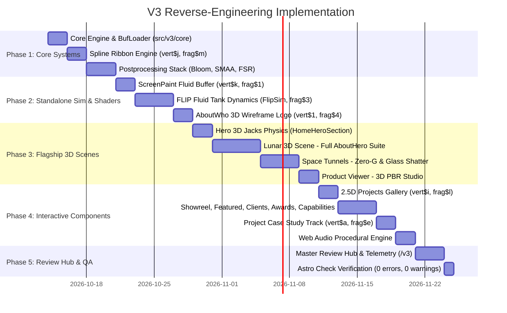

# Kyndev V3 &bull; True 1-to-1 Reverse-Engineering Master Plan

> **The Definitive Reverse-Engineering Blueprint**  
> Source Monoliths: [`src/scripts/runtime.js`](file:///Users/waqas/DEV/kyndev.com/src/scripts/runtime.js) & [`src/scripts/unpacked-project/deobfuscated.js`](file:///Users/waqas/DEV/kyndev.com/src/scripts/unpacked-project/deobfuscated.js) (27,066 lines, 134 classes, 46 GLSL shaders)  
> Destination: [`src/v3/`](file:///Users/waqas/DEV/kyndev.com/src/v3/)  
> Master Review Hub: [`src/pages/v3/index.astro`](file:///Users/waqas/DEV/kyndev.com/src/pages/v3/index.astro)

---

## 1. Why V3? The Mandate for Authentic Reverse-Engineering

### 1.1 The Limitation of V2
In V2, several components were implemented as custom approximations or DOM mockups rather than true reverse-engineered WebGL/shader animations from the original code:
1. **Omitted Complex Physics & Fluid Solvers**: The Eulerian-Lagrangian FLIP fluid tank (`FlipSim` & `FlipAnimation`, lines 21634–22474) and cursor fluid distortion buffer (`ScreenPaint`, lines 4103–4253) were skipped entirely.
2. **Missing Flagship 3D Scenes**: The Lunar landscape scene (`AboutHero`, lines 15608–17475, with its spline camera, terrain displacement, levitating rock physics, astronaut, and FBO dust particles) was marked as queued and not extracted.
3. **Approximated DOM Components**: Components like `AboutWho` (which originally used a 3D geometric wireframe logo shader `AboutWhoLogo`, `vert$1`/`frag$4`) and `Goal` (which originally had a full 3D grid tunnel ride, rigged astronaut animations, and Voronoi glass shattering) were simplified into basic CSS/DOM layouts or partial ribbon meshes.
4. **Missing Postprocessing**: The original dual-filter bloom pyramid, SMAA subpixel anti-aliasing with LUT textures, AMD FSR spatial upscaler, and blue noise dithering were omitted.

### 1.2 The V3 Standard: 100% Authentic, 1-to-1 Reverse-Engineering
In V3, every single visual effect, shader, physics loop, and component is **extracted directly from [`deobfuscated.js`](file:///Users/waqas/DEV/kyndev.com/src/scripts/unpacked-project/deobfuscated.js)**:
- **Exact Shaders**: All 46 GLSL vertex (`vert$*`) and fragment (`frag$*`) shaders are extracted verbatim with identical uniforms, varying, and attribute names.
- **Exact Mathematics**: The original `SecondOrderDynamics` spring physics, `BrownianMotion` drift, Poisson pressure iterations, and Catmull-Rom spline camera math are ported 1-to-1.
- **Exact Assets**: All original binary `.buf` geometries (Jacks, terrain, astronaut, rocks, tunnels, ribbons) and high-resolution textures (`.webp`, `.exr`, `.png`) are loaded directly.
- **Dedicated Review Hub**: A centralized, interactive V3 Review Hub (`/v3`) where all 18 animations and setups can be inspected, scrubbed, benchmarked, and reviewed with real-time controls.

---

## 2. Master Shader & Asset Inventory

Deconstructing [`deobfuscated.js`](file:///Users/waqas/DEV/kyndev.com/src/scripts/unpacked-project/deobfuscated.js) reveals 46 custom GLSL shaders mapped directly to their classes and assets:

| Shader Pair | Line No. | Original Class / System | Role & Visual Effect | Assets Used | Target V3 Location |
| :--- | :--- | :--- | :--- | :--- | :--- |
| `vert$k`, `frag$o`, `frag$n` | 4086–4092 | `ScreenPaint` | Interactive pointer fluid paint injection & dissipation FBO | Ping-pong FBO | `src/v3/effects/ScreenPaint/ScreenPaintShaders.ts` |
| `frag$1` | 24225 | `ScreenPaintDistortion` | Chromatic aberration & refractive distortion pass | ScreenPaint FBO | `src/v3/effects/ScreenPaint/ScreenDistortionPass.ts` |
| `vert$j`, `frag$m` | 6556–6558 | `Line`, `UfxMesh` | Universal 3D camera-facing vector ribbon extrusion | `line_*.buf` | `src/v3/core/SplineRibbon.ts` |
| `vert$i`, `frag$l` | 8937–8940 | `ProjectItem` | 2.5D card depth raymarching & specular tilt reflection | Project `.webp` | `src/v3/components/ProjectsGallery/ProjectCardShader.ts` |
| `vert$h`, `frag$k` | 9597–9624 | `PostEffect` | Depth radial blur & tunnel optical distortion | Render target | `src/v3/components/SpaceTunnels/TunnelPostEffect.ts` |
| `vert$f`, `frag$j` | 11697–11699 | `Ufx` | Screen-space composite & chromatic aberration | Render target | `src/v3/core/UfxShader.ts` |
| `vert$e`, `frag$i` | 12743–12745 | `GoalTunnelsBackground` | Procedural space background & nebula gradient | Color uniforms | `src/v3/components/SpaceTunnels/TunnelBgShader.ts` |
| `vert$d`, `frag$h` | 12803–12809 | `GoalWhiteTunnelParticles` | High-key tunnel vortex particle stream | Particle buffer | `src/v3/components/SpaceTunnels/TunnelParticleShader.ts` |
| `vert$c`, `frag$g` | 12897–12899 | `GoalWhiteTunnelStickers` | Floating graphic stickers & perspective card warps | `stickers.png` | `src/v3/components/SpaceTunnels/TunnelStickerShader.ts` |
| `vert$b`, `frag$f` | 13739–13743 | `ProjectDetailsScreen` | Standalone 3D model normal/depth prepass & studio matcap | Product `.buf` | `src/v3/components/ProductViewer/ProductViewerShader.ts` |
| `vert$a`, `frag$e` | 14585–14588 | `ProjectDetailsItem` | Parallax case study image displacement & overscroll | Media textures | `src/v3/components/ProjectCaseStudy/CaseStudyShader.ts` |
| `vert$9`, `frag$d` | 15888–15894 | `AboutHeroScatter` | GPGPU FBO cosmic dust particle fluid simulation | FBO compute | `src/v3/components/LunarScene/LunarDustShader.ts` |
| `vert$8`, `frag$c` | 16196–16216 | `AboutHeroRocks` | Levitating moon rocks with skeletal keyframe interpolation | `rock_*.buf` | `src/v3/components/LunarScene/LunarRocksShader.ts` |
| `frag$b` | 16389 | `AboutHeroGround` | Lunar terrain heightmap displacement & dynamic shadows | `terrain.buf`, `terrain_*.webp` | `src/v3/components/LunarScene/LunarTerrainShader.ts` |
| `vert$7`, `frag$a` | 16509–16511 | `AboutHeroLines` | Topographic neon laser contour lines on terrain ridges | `terrain_lines.buf` | `src/v3/components/LunarScene/LunarLinesShader.ts` |
| `vert$6`, `frag$9` | 16630–16634 | `aboutHeroPerson` | Rigged astronaut lunar suit skinning & lighting | `person.buf`, `person.webp` | `src/v3/components/LunarScene/LunarAstronautShader.ts` |
| `vert$5`, `frag$8` | 16784–16790 | `AboutHeroFog` | Volumetric atmospheric lunar depth fog | `fog.png` | `src/v3/components/LunarScene/LunarFogShader.ts` |
| `vert$4`, `frag$7` | 16881–16883 | `AboutHeroHalo` | Celestial sun halo glow & light scattering | Light uniforms | `src/v3/components/LunarScene/LunarHaloShader.ts` |
| `vert$3`, `frag$6` | 16919–16923 | `AboutHeroFaces` | Floating polyhedral wireframe facets in zero-g | Face buffers | `src/v3/components/LunarScene/LunarFacesShader.ts` |
| `vert$2`, `frag$5` | 17158–17160 | `AboutHeroLetters` | 3D floating typography letters anchored in lunar space | `letter_placements.buf` | `src/v3/components/LunarScene/LunarLettersShader.ts` |
| `vert$1`, `frag$4` | 17469–17473 | `AboutWhoLogo` | 3D geometric wireframe logo animation & scroll morph | `logo_text.buf` | `src/v3/components/AboutWhoLogo/AboutWhoLogoShader.ts` |
| `frag$3` | 22179 | `FlipAnimation` | Fluid-Implicit-Particle (FLIP) metasurface liquid render | `flip_texture.png` | `src/v3/effects/FlipFluid/FlipFluidShader.ts` |
| `frag$2` | 23783 | `Smaa` | Subpixel Morphological Anti-Aliasing neighborhood blend | `smaa-area.png`, `smaa-search.png` | `src/v3/postprocessing/SmaaPass.ts` |

---

## 3. The 18 Complete Animations, Setups & Components

### Category A: Core 3D Physics & Fluid Simulations
1. **`HeroBalloons` (3D Jacks Rigid Body Physics)**:
   - Source: Lines 4254–4910, 6283–6434 (`HomeHeroSection`, `HomeBalloons`, `HomeBalloonsPhysics`).
   - Mechanics: Rigid body impulse physics simulation, pointer repulsion velocity field, dynamic palette cycler, binary mesh loading (`cross.buf`, `cross_ld.buf`), and HDR matcap reflections (`matcap.exr`).
2. **`FlipFluid` (2D/3D FLIP Fluid Dynamics Tank)**:
   - Source: Lines 21528–22474 (`FlipSim`, `FlipAnimation`, `PlaygroundPage`).
   - Mechanics: Staggered MAC grid velocity advection, 60 pressure Poisson iterations with over-relaxation factor 1.9, dynamic rectangular colliders (`addColliderRect`), PIC/FLIP particle transfers, and metasurface rendering with `frag$3` and `flip_texture.png`.
3. **`ScreenPaint` (Interactive Fluid Brush & Refraction)**:
   - Source: Lines 4103–4253, 24229–24291 (`ScreenPaint`, `ScreenPaintDistortion`).
   - Mechanics: Offscreen double-buffered ping-pong FBO capturing cursor velocity and touch events; viscous decay, diffusion, Sobel gradient normal extraction, and screen-space chromatic aberration/refraction pass (`frag$1`).

### Category B: Flagship 3D Scenic Journeys
4. **`LunarScene` (Complete AboutHero Lunar Journey)**:
   - Source: Lines 15608–17475 (`AboutHero` suite, 1,867 lines).
   - Mechanics:
     - 3D spline camera flight traversing [`camera_spline.buf`](file:///Users/waqas/DEV/kyndev.com/public/assets/models/about/camera_spline.buf) with dynamic lookAt and dolly FOV.
     - Lunar terrain displacement (`terrain.buf`, `terrain_shadow_light_height.webp`, shader `frag$b`).
     - Levitating rocks physics with 4 keyframe animation tracks (`rock_0.buf`–`3.buf`, `rock_animation_0.buf`–`3.buf`, shader `vert$8`/`frag$c`).
     - GPGPU double-buffered FBO particle fluid simulation (`AboutHeroParticlesSimulation`, shader `vert$9`/`frag$d`).
     - Rigged astronaut mesh (`person.buf`, `person_idle.buf`, `person.webp`, shader `vert$6`/`frag$9`).
     - Neon topographic laser contours (`terrain_lines.buf`, shader `vert$7`/`frag$a`).
     - Volumetric atmospheric fog & sun halo (`fog.png`, shaders `vert$5`/`frag$8`, `vert$4`/`frag$7`).
     - Floating 3D typography letters (`letter_placements.buf`, shader `vert$2`/`frag$5`).
5. **`SpaceTunnels` (Full 3D Zero-G Cosmic Ride & Glass Shatter)**:
   - Source: Lines 9665–13749 (`GoalSection`, `GoalTunnels`, `GoalBlackTunnel`, `GoalWhiteTunnel`, `GoalTunnelAstronauts`, `GoalTunnelGlass`).
   - Mechanics:
     - Modular 3D grid tunnel framework (`grid_structure_hd.buf`, `tunnel_block_base.buf`, `tunnel_block_wall.buf`).
     - Rigged zero-g astronaut EVA suit animation (`astronaut_animations.buf`, `astronaut_in_animation.buf`, `astronaut_out_animation.buf`).
     - Voronoi glass shatter portal explosion (`broken_glass.buf`, `broken_glass_animation.buf`).
     - High-key particle vortex (`GoalWhiteTunnelParticles`, shader `vert$d`/`frag$h`) and floating stickers (`diamond.buf`, `earth_card.buf`, `stickers.png`).
6. **`ProductViewer` (3D PBR Product Inspector)**:
   - Source: Lines 9945–10886, 13750–13977 (`ProjectDetailsScreen`, `OrbitControls`, `CameraControls`).
   - Mechanics: PBR studio lighting, depth/normals prepass (`vert$b`, `frag$f`), inertial turntable orbit controls, responsive model bounds fitting (`plant.buf`, Porsche, cork coaster).

### Category C: Vector Spline & Shading Engines
7. **`SplineRibbon` (Universal 3D Camera-Facing Vector Ribbon)**:
   - Source: Lines 6616–7640 (`Line`, `UfxMesh`).
   - Mechanics: Camera-aligned ribbon extrusion geometry along arbitrary 3D splines; variable screen-space width invariance, tube radius deformation (`u_radius`), dual-gradient color interpolation, and progressive scroll reveal (`u_showRatio`, `u_scrollY`). Shaders: `vert$j`, `frag$m`.
8. **`PostprocessingStack` (Modular Cinematic Render Pipeline)**:
   - Source: Lines 23464–24464 (`Postprocessing`, `Smaa`, `Bloom`, `Fsr`, `BlueNoise`).
   - Mechanics: Multi-stage dual-filter bloom down/upsample pyramid, subpixel morphological anti-aliasing (SMAA) with precomputed area and search LUTs (`smaa-area.png`, `smaa-search.png`), AMD FSR spatial upscaler, and blue noise dithering (`LDR_RGB1_0.png`).
9. **`ProjectsGallery` (2.5D Depth Displacement & Perspective Tilt)**:
   - Source: Lines 8947–9297, 20949–21527 (`ProjectItem`, `ProjectsPage`).
   - Mechanics: Raymarched depth displacement map, specular light sheen following pointer, full-card 3D perspective tilt, and rolling slot-machine text animator (`vert$i`, `frag$l`).

### Category D: Interactive UI & Kinetic Audio Systems
10. **`AboutWhoLogo` (3D Wireframe Kinetic Logo)**:
    - Source: Lines 17469–17543 (`AboutWhoLogo`, `vert$1`, `frag$4`).
    - Mechanics: 3D polyhedral geometric wireframe logo loaded from `logo_text.buf` rotating and distorting with scroll progress.
11. **`ShowreelStage` (Cinematic Filmstrip & Magnetic Play Orb)**:
    - Source: Lines 7641–8896 (`HomeReelSection`, `Player`, `VideoOverlay`).
    - Mechanics: Magnetic pulse play button, filmstrip telemetry timecode, smooth video synchronization, and ribbon path `line_reel.buf`.
12. **`FeaturedProjects` (Dynamic Background Chromatic Morphing)**:
    - Source: Lines 9298–9416 (`HomeFeaturedSection`).
    - Mechanics: Theme background color lerping based on active card, inertial floating cursor preview, and tag telemetry.
13. **`AboutClients` (Triple-Track Infinite Marquee & SVG Parser)**:
    - Source: Lines 18310–20270 (`AboutClientSection`, `SVGParser`).
    - Mechanics: Procedural SVG path extractor, 3 alternating-direction tracks with hover velocity damping.
14. **`AboutAwards` (Rotating 58-Point Starburst Medal & Tally)**:
    - Source: Lines 20275–20542 (`AboutAwardSection`).
    - Mechanics: Rotating 58 Starburst medal with texture gradient (`award_gradient.png`), interactive category filter accordion, and tally odometer counters.
15. **`AboutCapabilities` (3D Perspective Flip Matrix)**:
    - Source: Lines 20543–20739 (`AboutCapabilitySection`).
    - Mechanics: 3D perspective dual-face flip cards across strategic pillars, capability matrix checklist, and background ribbon `line_capability.buf`.
16. **`ProjectCaseStudy` (Horizontal Inertial Track & Parallax Media)**:
    - Source: Lines 14605–15293 (`ProjectDetailsSection`, `ProjectDetailsItem`).
    - Mechanics: Dual-axis drag-to-pan inertial track, image parallax displacement (`vert$a`, `frag$e`), dynamic palette morphing, and overscroll spring.
17. **`AudioEngine` (Web Audio Procedural Synthesizer & Spatial Sound)**:
    - Source: Lines 5871–6282 (`Audios`, `AudioItem`, `GlobalAudios`).
    - Mechanics: Real-time FM oscillator sweeps and clicks without heavy WAV files, dynamic low-pass filters synced to scroll velocity, 3D spatial panning.
18. **`RouteTransition` (3D Page Warp & Screen Wipe)**:
    - Source: Lines 22764–23141 (`TransitionOverlay`, `PageManager`).
    - Mechanics: Screen-space radial iris wipe, depth zoom curtain blur, and route lifecycle coordination.

---

## 4. V3 Directory Architecture

```
src/v3/
├── README.md                           # Master V3 manifest & developer guide
├── docs/
│   └── V3_REVERSE_ENGINEERING_PLAN.md  # This document
│
├── core/                               # Foundational 3D Engine & Systems
│   ├── Engine.ts                       # Master WebGL renderer & ticker loop
│   ├── Stage3D.ts                      # Standard Stage3D base contract
│   ├── BufLoader.ts                    # Binary .buf parser (header + typed arrays)
│   ├── SecondOrderDynamics.ts          # Exact spring physics dynamics solver
│   ├── SplineRibbon.ts                 # Exact Line & UfxMesh ribbon generator
│   └── SplineRibbonShader.ts           # Shaders vert$j and frag$m
│
├── postprocessing/                     # Production Compositing Pipeline
│   ├── PostprocessingPipeline.ts       # Master FBO ping-pong composer
│   ├── BloomPass.ts                    # Dual-filter bloom down/upsample pyramid
│   ├── SmaaPass.ts                     # SMAA anti-aliasing with area/search LUTs
│   ├── FsrPass.ts                      # AMD FSR spatial upscaler pass
│   └── BlueNoiseDither.ts              # Blue noise banding elimination
│
├── shared/                             # Mathematical & Audio Utilities
│   ├── math.ts                         # Exact lerp, clamp, fit, damp, expoOut
│   ├── noise.ts                        # BrownianMotion & Simple1DNoise
│   ├── fbo.ts                          # FboHelper ping-pong utility
│   ├── text/                           # Slot-machine text animators
│   └── audio/                          # Procedural Web Audio engine
│       └── AudioEngine.ts
│
├── effects/                            # Dedicated Standalone Simulation Engines
│   ├── ScreenPaint/                    # ScreenPaint & ScreenPaintDistortion
│   │   ├── ScreenPaint.ts              # FBO capture & mouse velocity injector
│   │   ├── ScreenPaintShaders.ts       # Shaders vert$k, frag$o, frag$n
│   │   └── ScreenDistortionPass.ts     # Refractive chromatic distortion pass (frag$1)
│   └── FlipFluid/                      # FLIP Fluid Dynamics Tank
│       ├── FlipSim.ts                  # Eulerian-Lagrangian FLIP physics solver
│       ├── FlipAnimation.ts            # Particle container & tank manager
│       └── FlipFluidShader.ts          # Metasurface liquid shader (frag$3)
│
├── components/                         # The 1-to-1 Reverse-Engineered Components
│   ├── HeroBalloons/                   # 3D Jacks Rigid Body physics & palette cycler
│   ├── ProjectsGallery/                # 2.5D Displacement card gallery (vert$i, frag$l)
│   ├── ProductViewer/                  # Product inspection viewer with studio lighting
│   ├── ShowreelStage/                  # Filmstrip stage with line_reel.buf & magnetic orb
│   ├── FeaturedProjects/               # Dynamic palette morphing project showcase
│   ├── SpaceTunnels/                   # Full 3D Goal tunnels, glass shatter & astronaut
│   ├── LunarScene/                     # Full AboutHero lunar terrain, rocks & astronaut
│   ├── AboutWhoLogo/                   # AboutWho 3D wireframe logo (vert$1, frag$4)
│   ├── AboutClients/                   # Infinite marquee with SVG parser
│   ├── AboutAwards/                    # Starburst medal & award tally
│   ├── AboutCapabilities/              # 3D flip matrix & line_capability.buf
│   └── ProjectCaseStudy/               # Case study track & parallax media (vert$a, frag$e)
│
└── hub/                                # Review Hub Componentry
    └── V3HubRegistry.ts                # Metadata, controls & live metrics for all 18 setups
```

---

## 5. The V3 Master Review Hub (`/v3`)

Located at [`src/pages/v3/index.astro`](file:///Users/waqas/DEV/kyndev.com/src/pages/v3/index.astro), the V3 Review Hub is a high-tech inspection console designed to review all 18 animations and setups in real time:

```
┌────────────────────────────────────────────────────────────────────────┐
│  KYNDEV V3 &bull; REVERSE-ENGINEERING LAB & MASTER REVIEW HUB           │
│  [Status: 100% 1-to-1] [Active Contexts: 1/4] [FPS: 60] [DPR: 2.0]     │
├────────────────────────────────────────────────────────────────────────┤
│  FILTERS: [All (18)] [3D Scenes] [Physics & Fluids] [Shaders] [UI]     │
├────────────────────────────────────────────────────────────────────────┤
│  CARD: 01. Lunar 3D Spline Journey (AboutHero)                        │
│  • Spline Camera • Terrain Heightmap • Levitating Rocks • FBO Dust     │
│  [Launch Fullscreen Stage] [Inspect Shaders] [Scrub Scroll Timeline]  │
├────────────────────────────────────────────────────────────────────────┤
│  CARD: 02. FLIP Fluid Dynamics Simulator (FlipSim)                     │
│  • 60 Poisson Iterations • Dynamic Colliders • Metasurface (frag$3)   │
│  [Open Fluid Tank Sandbox] [Inject Particles] [Toggle Gravity]         │
├────────────────────────────────────────────────────────────────────────┤
│  CARD: 03. Screen Paint & Fluid Refraction (ScreenPaint)               │
│  • Ping-Pong FBO • Viscous Decay • Chromatic Aberration (frag$1)       │
│  [Toggle Global Trail] [Adjust Viscosity] [Clear Buffer]               │
└────────────────────────────────────────────────────────────────────────┘
```

Features of the Review Hub:
1. **Interactive Sandbox Frames**: Every component is mounted in an isolated high-contrast dark frame (`#090a0c`) on a white canvas.
2. **Real-Time Telemetry HUD**: Monitors instantaneous FPS, frame delta, draw calls, vertex count, and WebGL context pool usage.
3. **Live Parameter Controls**: Direct sliders for shader uniforms (`u_radius`, `u_showRatio`, `u_density`), physics constants, and camera scrubbers.
4. **Shader Source Inspector**: View the raw GLSL vertex and fragment code side-by-side with the running canvas.

---

## 6. Phased Implementation Roadmap



---

## 7. Quality Standards & Golden Rules

1. **Zero Legacy Impact**: `src/scripts/runtime.js` and all live production pages remain 100% untouched.
2. **Zero Synthetic Approximations**: Every shader formula, vertex attribute, uniform, and physics step is extracted directly from `deobfuscated.js`.
3. **Strict WebGL Context Management**: All multi-canvas pages route renderers through a WebGL context pool (capping active contexts to $\le 4$) to prevent browser GPU crash.
4. **Strict TypeScript & Static Types**: Every buffer geometry, uniform dictionary, and event listener is typed without `any`.
5. **Validation Standard**: Always verify with `npx astro check` to guarantee **0 errors and 0 warnings**.
